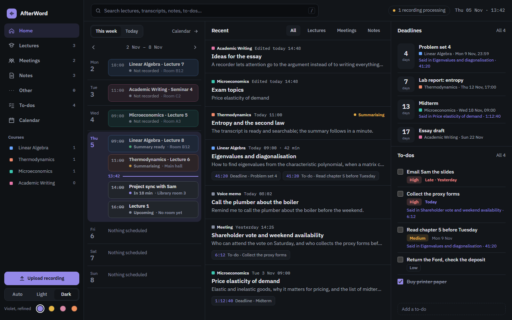
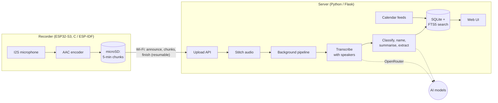
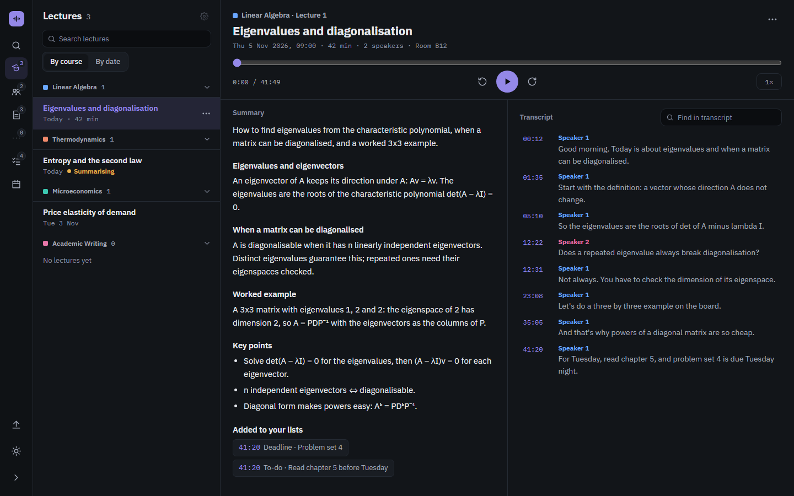
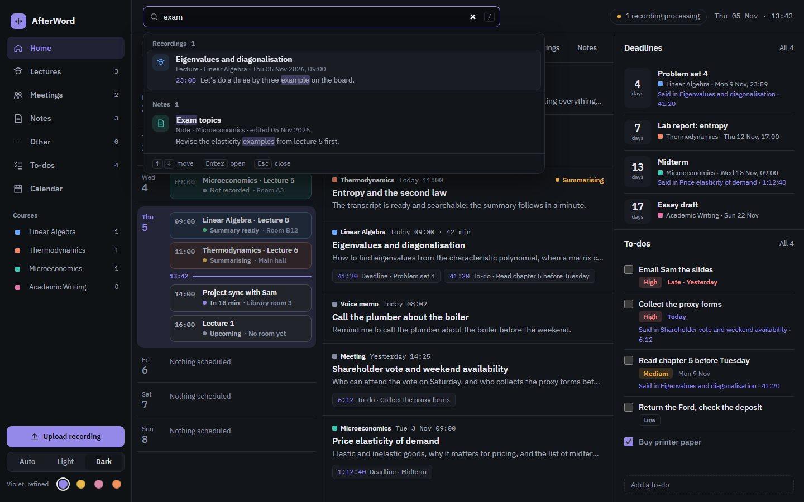
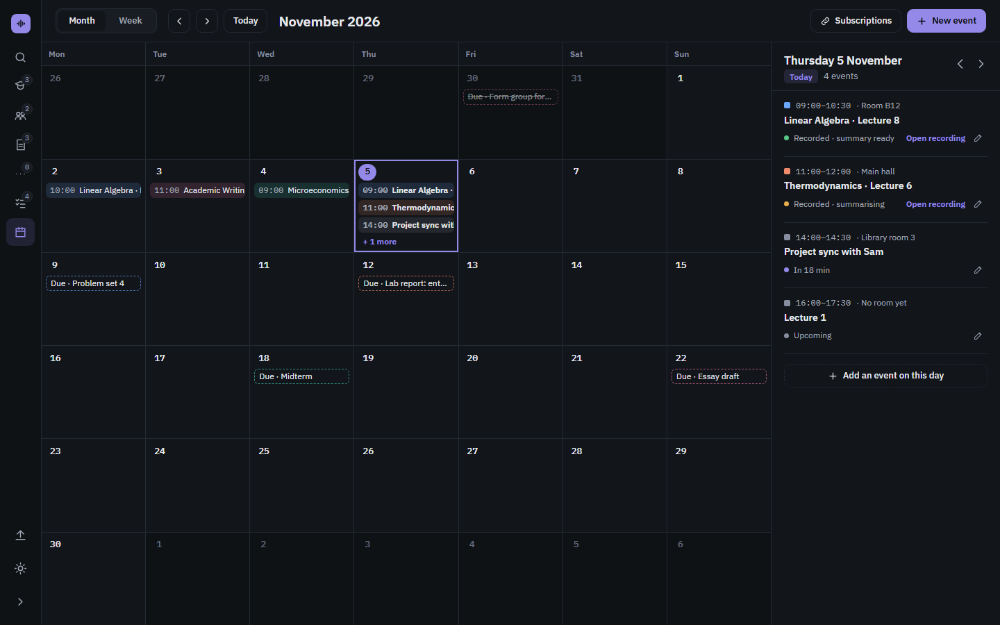
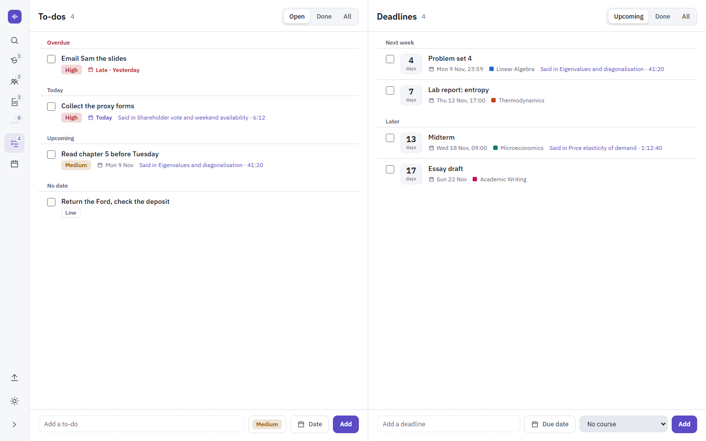
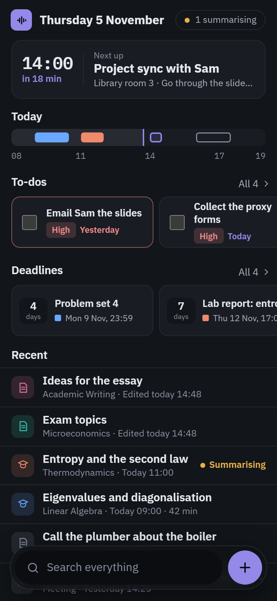
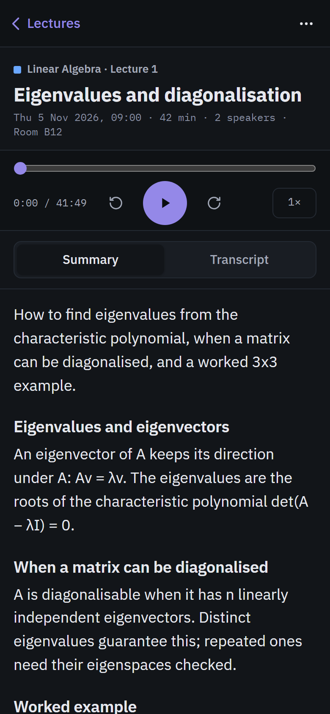
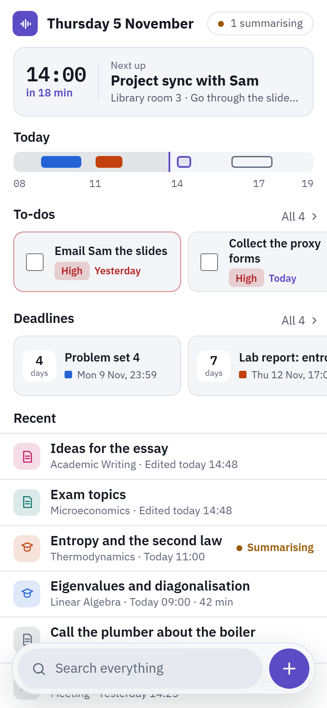

# AfterWord

A pocket recorder and a self-hosted web app that turn lectures and meetings
into transcripts, summaries, to-dos and calendar entries you can search and
play back from the exact moment something was said.

<picture>
  <source media="(prefers-color-scheme: light)" srcset="docs/screenshots/home-light.png">
  
</picture>

## What it does

- **Records** with one button on a small ESP32-S3 device: hours of audio,
  encoded live and saved in 5-minute chunks to a microSD card, with no
  phone and no Wi-Fi needed while recording.
- **Uploads** on its own once it is back on Wi-Fi, and deletes a
  recording only after the server confirms it has every chunk.
- **Understands** each recording on the server: a transcript with
  speakers, the kind of recording (lecture, meeting, voice memo, a spoken
  request), a title and a summary in sections, in English or Russian.
- **Suggests** what to file: deadlines, to-dos and dated events it hears
  are listed under the summary, and you confirm each one before it goes
  into your lists and the calendar, linked to the moment in the audio.
- **Finds** anything again: one search box across transcripts, summaries,
  notes, tasks and the calendar, matching word forms in both languages.
- **Fits the day:** lectures are matched to the timetable (imported or
  subscribed calendars), and the web app works on desktop and phone, in
  light and dark, with four colour schemes.

## How it works



Some of the engineering inside:

- **Nothing is lost on the device.** The open chunk is flushed every 10 s,
  so a power cut costs at most 10 s, and a half-written last frame is
  trimmed on the next boot. A ring buffer in PSRAM absorbs SD card stalls.
- **Uploads are safe to repeat.** Each chunk is written atomically and can
  be sent again; finishing reports any missing chunks, which the device
  re-sends. A recording leaves the SD card only after the server has
  stitched it.
- **The AI pipeline survives restarts.** One background worker processes
  recordings in order; after a restart, anything stranded mid-way is
  picked up again without repeating finished steps. Long recordings are
  sent for transcription in pieces, and a piece that fails is split and
  retried.
- **Search is bilingual.** Words are stemmed with English or Russian rules
  ("лекция" finds "лекции"), indexed in SQLite FTS5 and ranked with BM25;
  every hit opens the recording at the moment it was said.
- **Secure by default.** The server listens only on its own machine unless
  a password is set; the recorder authenticates with its own token.

More detail: [server/README.md](server/README.md) (setup, configuration,
the device protocol, the pipeline) and
[hardware/README.md](hardware/README.md) (parts, wiring, firmware design,
test plan).

## Screenshots

| A lecture: player, summary and transcript | Search across everything |
|---|---|
|  |  |
| **Calendar with recordings matched to events** | **To-dos and deadlines, in the light theme** |
|  |  |

<p>
  
  
  
</p>

All data in the screenshots is made up (the demo server below).

## Tech stack

| | |
|---|---|
| **Recorder** | ESP32-S3 (C, ESP-IDF v6.1, FreeRTOS), INMP441 I2S microphone, microSD over SPI, Espressif's AAC-LC encoder |
| **Server** | Python 3.11+, Flask, waitress, SQLite with FTS5, ffmpeg |
| **AI** | Through OpenRouter: a speech-to-text model with speaker labels and a text model (which can also come from any OpenAI-compatible API); both are settings |
| **Web UI** | Server-rendered Jinja templates with plain CSS and JavaScript; no build step |
| **Quality** | About 600 unit and integration tests (`unittest`), ruff for linting and formatting, pinned dependencies |

## Try it

The demo server runs the web app with made-up data: no recorder, no API
keys and no real data needed. It needs Python 3.11 or newer (ffmpeg is
optional; with it, the demo lecture gets a playable silent track).

```powershell
cd server
python -m venv .venv
.venv\Scripts\python.exe -m pip install -r requirements.txt
.venv\Scripts\python.exe scripts\demo_server.py      # http://127.0.0.1:8010
```

On Linux or macOS, use `.venv/bin/python` instead. To run it for real, with
the recorder and AI keys, see [server/README.md](server/README.md); to build
the recorder, see [hardware/README.md](hardware/README.md).

## Repository layout

```
server/       Flask app: upload API, AI pipeline, search, web UI, tests
hardware/
├── firmware/ ESP-IDF project for the recorder (C)
└── tools/    serial logger and audio checks used while testing the device
docs/         screenshots
```

## Status

AfterWord is a personal project, built for and used by its author.

- **Done:** the breadboard recorder (it passed the full test plan in
  [hardware/README.md](hardware/README.md)), the server and AI pipeline,
  search, calendar import and subscriptions, and the web app for desktop
  and phone.
- **Next:** a soldered recorder with a battery, then hosting the server
  on a VPS behind HTTPS.

## About

Built by Simon Pozigun, with [Claude Code](https://claude.com/claude-code)
as a pair programmer for parts of the code and the UI design.

## License

Copyright © 2026 Simon Pozigun. All rights reserved; see [LICENSE](LICENSE).
The code is public to read, not to reuse.
